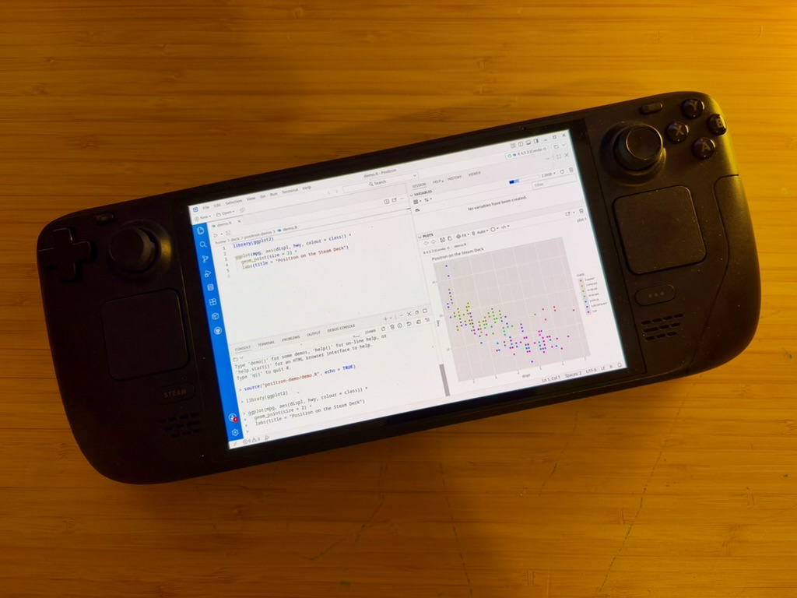

# Positron on Steam Deck

[Positron](https://positron.posit.co) with R on a Steam Deck, in Desktop Mode
and Game Mode. Unofficial; not affiliated with Posit.



- Official Linux x64 build, unpacked from Posit's `.deb` into `~`
- R + tidyverse from conda-forge via micromamba
- No root, no pacman; survives SteamOS updates
- Tested on Steam Deck OLED, SteamOS 3.9.5, Positron 2026.11.1-4

## Install

Desktop Mode, Konsole:

```sh
curl -L https://github.com/gkaramanis/positron-on-steam-deck/archive/refs/heads/main.tar.gz | tar xz
cd positron-on-steam-deck-main
bash scripts/install.sh --add-to-steam
```

Takes a few minutes (Positron ~500 MB, R ~1 GB). Safe to re-run.

| Option | |
|---|---|
| `--remove GROUPS` | remove optional parts, comma-separated or `all` (see below) |
| `--add-to-steam` | add the Game Mode shortcut to Steam |
| `VERSION` | another Positron version, e.g. `2026.12.0-1`; re-run to update |
| `--sha256 HASH` | check the downloaded `.deb` |

## Remove what you don't need

Nothing optional is removed by default.

```sh
bash scripts/install.sh --remove copilot,assistant,quarto
bash scripts/install.sh --remove all      # app folder 2.1 GB → ~1 GB
```

| Group | Removes |
|---|---|
| `copilot` | GitHub Copilot Chat, Copilot CLI |
| `assistant` | Positron Assistant, next-edit suggestions |
| `python` | Python support, Jupyter, debugpy, pyrefly, ruff, reticulate (SteamOS has no Python) |
| `quarto` | Quarto extension and bundled CLI (~420 MB) |
| `remote` | SSH, dev containers, tunnels, HPC modules |
| `cloud` | Snowflake and Databricks drivers, Posit Publisher |
| `node` | Node.js debugger helpers |
| `locales` | non-English UI languages |
| `settings` | telemetry and update checks off, solid cursor, reduced motion, no minimap |

Always removed: Microsoft sign-in (needs `libwebkit2gtk`), ODBC (needs
`libodbc`), Windows-only binaries.

- Re-run with fewer groups to restore: Positron is unpacked again.
- Settings stay changed; edit `~/.config/Positron/User/settings.json`.
- Quarto CLI back: `~/.local/bin/micromamba install -n r quarto`.

## Game Mode

After install, in Steam:

1. Shortcut missing? Add `~/Applications/positron-gamemode/Positron` as a
   non-Steam game.
2. Controller layout: *Your Layouts → Positron Deck*.
3. Icon: Properties → Shortcut → `~/Applications/positron-gamemode/icon.png`.

| Control | Action |
|---|---|
| right trackpad | mouse |
| R2 / L2 | click |
| left trackpad | scroll |
| A | run line |
| Y | command palette |
| L1 / R1 | previous / next tab |
| X or Steam + X | keyboard |
| left stick | R snippet wheel (aim, click), untested |

Snippet wheel (untested on the Deck): `<-` `==` `%in%` `|>` `~` `library()` `""` `mutate()`
`summarise(.by)` `c()` `ggplot() + geom_()` `function() {}`. Tab jumps to the
next gap.

New folders open in Restricted Mode; trust them so R can start.

## Fixes in the launcher

| Problem | Fix |
|---|---|
| `conda: command not found` when R starts | `conda-shim.sh` forwards `conda` to micromamba |
| keyring prompt in Game Mode | `--password-store=kwallet6`, wallet services started with a display |
| `gameoverlayrenderer.so … ELFCLASS32` in R console | `LD_PRELOAD` unset |
| on-screen keyboard on every focus | `GTK_IM_MODULE` / `QT_IM_MODULE` unset |
| blurry upscaled window | saved window reset to maximized 1280×800 |
| black screen after quitting | leftover kernel supervisor (`kcserver`) stopped on exit |

## Files on the Deck

| Path | |
|---|---|
| `~/Applications/positron-<version>` | Positron, one folder per version |
| `~/Applications/positron` | symlink to the active version |
| `~/Applications/positron-gamemode/` | Game Mode launcher, log, icon |
| `~/micromamba/envs/r` | R |
| `~/.config/positron-deck/` | conda shim, `~/.bash_profile` backup |

Uninstall: delete those, plus the `positron-deck` lines in `~/.bash_profile`.

## Repo

- `scripts/install.sh` — install, update, remove groups
- `scripts/Positron` — Game Mode launcher
- `scripts/conda-shim.sh` — `conda` → micromamba
- `scripts/snippet-keys.json` — snippet keybindings
- `steam/positron_deck_0.vdf` — controller layout
- `steam/artwork/` — library art source and `render.sh` (renders not included)

MIT license. Positron is © Posit Software, PBC, under its own license.
